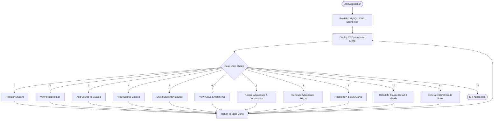
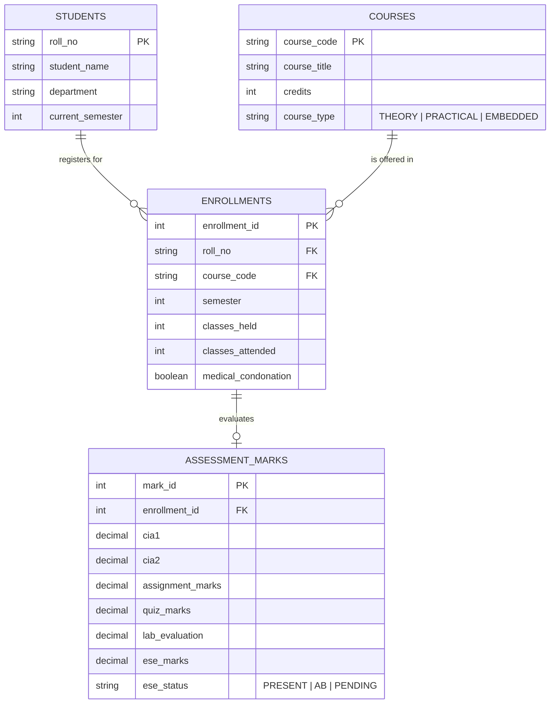

# KEC Academic Management & Continuous Evaluation System
### Kongu Engineering College (Autonomous) — Regulation 2024 (R2024)
**Department of Information Technology** | **Course: 24ITT32 – Programming in Java**

---

## Student & Project Credentials

| Attribute | Details |
| :--- | :--- |
| **Student Name** | **VISHAL RAGAV V S** |
| **Roll Number** | **25ITR176** |
| **Degree & Branch** | B.Tech - Information Technology |
| **Institution** | Kongu Engineering College (Autonomous), Perundurai, Erode |
| **Course Code & Title** | 24ITT32 – Programming in Java |
| **Regulation** | Kongu Engineering College (Autonomous) Regulation 2024 (R2024) |
| **Repository** | [https://github.com/VISHAL51053/java_JDBC](https://github.com/VISHAL51053/java_JDBC) |
| **Project Documentation** | [`docs/JAVA ASSIGNMENT.pdf`](docs/JAVA%20ASSIGNMENT.pdf) |
| **Demonstration Video** | [`video/java kec academic portal-video.mp4`](video/java%20kec%20academic%20portal-video.mp4) |

---

## Table of Contents
1. [Aim & Objectives](#aim--objectives)
2. [Regulation 2024 (R2024) Evaluation Rules](#regulation-2024-r2024-evaluation-rules)
   - [Attendance Eligibility Rules](#1-attendance-eligibility-rules)
   - [Continuous Internal Assessment (CIA) Structure](#2-continuous-internal-assessment-cia-structure)
   - [Course Types, Weightages & Passing Minimums](#3-course-types-weightages--passing-minimums)
   - [Grading Scale & Grade Points](#4-grading-scale--grade-points)
   - [SGPA & Percentage Formulas](#5-sgpa--percentage-formulas)
3. [System Architecture & Design](#system-architecture--design)
   - [DAO Pattern & Component Roles](#dao-pattern--component-roles)
   - [Application Flow Diagram](#application-flow-diagram)
4. [Database Design & Schema](#database-design--schema)
   - [Entity-Relationship (ER) Diagram](#entity-relationship-er-diagram)
   - [Table Definitions](#table-definitions)
5. [Console Menu & Features (12 Operations)](#console-menu--features-12-operations)
6. [Getting Started & Setup Guide](#getting-started--setup-guide)
   - [Prerequisites](#prerequisites)
   - [Database Setup](#database-setup)
   - [Environment Variables](#environment-variables)
   - [Compile & Run](#compile--run)
7. [Sample Execution & Terminal Outputs](#sample-execution--terminal-outputs)
8. [Media & Project Assets](#media--project-assets)
9. [References](#references)

---

## Aim & Objectives

### Aim
Development of the **Kongu Engineering College (Autonomous) Regulation 2024 Student Academic & Continuous Evaluation System** using **Java (JDBC)** and **MySQL**.

### Objective
Design and implement a robust, database-driven Java console application utilizing the Data Access Object (DAO) architectural pattern to:
- Securely maintain student profiles, course offerings, and semester enrollments.
- Record incremental Continuous Internal Assessment (CIA) marks and End Semester Examination (ESE) results.
- Enforce institutional attendance eligibility criteria (including medical condonation compliance).
- Compute final weighted scores, letter grades, grade points, and Semester Grade Point Average (SGPA) strictly aligned with **KEC Autonomous Regulation 2024**.

---

## Regulation 2024 (R2024) Evaluation Rules

### 1. Attendance Eligibility Rules
Attendance is computed per enrollment as:

$$\text{Attendance Percentage} = \left( \frac{\text{Classes Attended}}{\text{Classes Held}} \right) \times 100$$

| Attendance Range | Medical Condonation | Status | Academic Consequence |
| :--- | :---: | :--- | :--- |
| **$\ge 75\%$** | Not Required | **ESE Eligible** | Permitted to write End Semester Examinations. |
| **$65\% \le \text{Att.} < 75\%$** | **Approved (`Y`)** | **Conditional Eligible** | Permitted to write ESE under approved medical condonation. |
| **$65\% \le \text{Att.} < 75\%$** | **Not Approved (`N`)**| **SA (Shortage of Attendance)** | Barred from ESE; Grade = `SA`, Grade Point = `0`. |
| **$< 65\%$** | N/A | **SA (Shortage of Attendance)** | Strictly barred from ESE; must re-register the course. |

---

### 2. Continuous Internal Assessment (CIA) Structure
For every enrolled course, the CIA average is calculated on a 100-mark base across five components:

$$\text{CIA Average (out of 100)} = \frac{\text{CIA 1} + \text{CIA 2} + \text{Assignment} + \text{Quiz} + \text{Lab Evaluation}}{5}$$

*Note: For pure Theory courses, Lab Evaluation can be input as 0 or customized based on internal assessment guidelines.*

---

### 3. Course Types, Weightages & Passing Minimums
The system distinguishes three distinct academic course categories under KEC R2024:

| Course Type | CIA Weightage | ESE Weightage | ESE Max Marks | ESE Passing Minimum | Final Passing Minimum |
| :--- | :---: | :---: | :---: | :---: | :---: |
| **THEORY** | **40%** (0.40) | **60%** (0.60) | **60** | **27 / 60** (45%) | **50 / 100** |
| **PRACTICAL** | **60%** (0.60) | **40%** (0.40) | **40** | **20 / 40** (50%) | **50 / 100** |
| **EMBEDDED** | **50%** (0.50) | **50%** (0.50) | **50** | **22.5 / 50** (45%) | **50 / 100** |

#### Calculation Formulas:
1. **Weighted CIA**:
   $$\text{Final CIA} = \text{CIA Average} \times \text{CIA Weight}$$
2. **Weighted ESE**:
   $$\text{Final ESE} = \left( \frac{\text{ESE Marks Earned}}{\text{ESE Maximum Marks}} \times 100 \right) \times \text{ESE Weight}$$
3. **Final Total (out of 100)**:
   $$\text{Final Total} = \text{Final CIA} + \text{Final ESE}$$

---

### 4. Grading Scale & Grade Points

| Marks Range (Total) | Letter Grade | Grade Point | Remarks |
| :---: | :---: | :---: | :--- |
| **$91 - 100$** | **O** | **10** | Outstanding |
| **$81 - 90$** | **A+** | **9** | Excellent |
| **$71 - 80$** | **A** | **8** | Very Good |
| **$61 - 70$** | **B+** | **7** | Good |
| **$50 - 60$** | **B** | **6** | Above Average |
| **$< 50$ or ESE $<$ Min** | **RA** | **0** | Re-Appear (Failed) |
| **Absent in ESE** | **AB** | **0** | Absent |
| **Attendance Shortage** | **SA** | **0** | Barred / Shortage of Attendance |

---

### 5. SGPA & Percentage Formulas

#### Semester Grade Point Average (SGPA):
$$\text{SGPA} = \frac{\sum_{i=1}^{n} \left( \text{Course Credits}_i \times \text{Grade Point}_i \right)}{\sum_{i=1}^{n} \text{Course Credits}_i}$$

#### Equivalent Percentage:
$$\text{Percentage} = \text{SGPA} \times 10$$

---

## System Architecture & Design

### DAO Pattern & Component Roles
The codebase follows the industry-standard **Data Access Object (DAO)** pattern to decouple persistence logic from business and presentation logic:

```
src/main/java/kec/
├── App.java            --> Interactive Console CLI Controller (12 Menu Options)
├── DBConnection.java   --> JDBC Connection Manager & Env-variable configuration
├── StudentDAO.java     --> Student record management (Registration)
├── CourseDAO.java      --> Course catalog management (Code, Title, Credits, Type)
├── EnrollmentDAO.java  --> Course enrollment & student semester validation
├── AttendanceDAO.java  --> Attendance tracking & R2024 eligibility checks
├── AssessmentDAO.java  --> Incremental marks entry (CIA1, CIA2, Lab, Quiz, ESE)
├── ResultDAO.java      --> Individual course evaluation, weights, grades & result
├── SGPADao.java        --> Tabular Semester Grade Sheet & SGPA generation
└── AcademicDAO.java    --> Student directory queries
```

### Application Flow Diagram



---

## Database Design & Schema

### Entity-Relationship (ER) Diagram



### Table Definitions

The repository includes a ready-to-run [`schema.sql`](schema.sql) file containing complete table definitions and foreign key constraints:

```sql
CREATE DATABASE IF NOT EXISTS kec_academic;
USE kec_academic;

-- Students Table
CREATE TABLE IF NOT EXISTS students (
    roll_no VARCHAR(10) PRIMARY KEY,
    student_name VARCHAR(100) NOT NULL,
    department VARCHAR(10) NOT NULL,
    current_semester INT NOT NULL
);

-- Courses Table
CREATE TABLE IF NOT EXISTS courses (
    course_code VARCHAR(10) PRIMARY KEY,
    course_title VARCHAR(100) NOT NULL,
    credits INT NOT NULL,
    course_type VARCHAR(10) NOT NULL CHECK (course_type IN ('THEORY', 'PRACTICAL', 'EMBEDDED'))
);

-- Enrollments Table
CREATE TABLE IF NOT EXISTS enrollments (
    enrollment_id INT AUTO_INCREMENT PRIMARY KEY,
    roll_no VARCHAR(10) NOT NULL,
    course_code VARCHAR(10) NOT NULL,
    semester INT NOT NULL,
    classes_held INT DEFAULT 0,
    classes_attended INT DEFAULT 0,
    medical_condonation BOOLEAN DEFAULT FALSE,
    FOREIGN KEY (roll_no) REFERENCES students(roll_no) ON DELETE CASCADE,
    FOREIGN KEY (course_code) REFERENCES courses(course_code) ON DELETE CASCADE,
    UNIQUE KEY uq_student_course_semester (roll_no, course_code, semester)
);

-- Assessment Marks Table
CREATE TABLE IF NOT EXISTS assessment_marks (
    mark_id INT AUTO_INCREMENT PRIMARY KEY,
    enrollment_id INT NOT NULL UNIQUE,
    cia1 DECIMAL(5,2) DEFAULT NULL,
    cia2 DECIMAL(5,2) DEFAULT NULL,
    assignment_marks DECIMAL(5,2) DEFAULT NULL,
    quiz_marks DECIMAL(5,2) DEFAULT NULL,
    lab_evaluation DECIMAL(5,2) DEFAULT NULL,
    ese_marks DECIMAL(5,2) DEFAULT NULL,
    ese_status VARCHAR(10) DEFAULT 'PENDING',
    FOREIGN KEY (enrollment_id) REFERENCES enrollments(enrollment_id) ON DELETE CASCADE
);
```

---

## Console Menu & Features (12 Operations)

| # | Menu Option | Functionality | Key Validations |
| :---: | :--- | :--- | :--- |
| **1** | **Register Student** | Adds a student with Roll Number, Name, Department, Semester. | Unique primary key check on `roll_no`. |
| **2** | **View Registered Students** | Lists all registered students in the system. | Handles empty record state gracefully. |
| **3** | **Add Course** | Registers a new subject with Code, Title, Credits, and Type. | Enforces `THEORY`, `PRACTICAL`, or `EMBEDDED`. |
| **4** | **View Courses** | Displays the full catalog of available courses. | Ordered alphabetically by course code. |
| **5** | **Enroll Student in Course** | Enrolls a student into a specific course for the semester. | Verifies student exists and semester matches. |
| **6** | **View Enrollments** | Displays active course enrollments with student and course names. | Relational `JOIN` across students and courses. |
| **7** | **Record Attendance** | Logs classes held, classes attended, and medical condonation. | Bounds checking ($0 \le \text{attended} \le \text{held}$). |
| **8** | **View Attendance Report** | Summary of attendance percentages and eligibility flags. | Formatted percentage display with condonation notes. |
| **9** | **Record Assessment Marks** | Enters CIA1, CIA2, Assignment, Quiz, Lab, and ESE marks. | Scale bounds (0-100 for CIA, type-based max for ESE). |
| **10**| **Calculate Student Result** | Computes course-level grade, weighted scores, and pass status. | Attendance check, ESE minimum check, R2024 formula. |
| **11**| **Calculate SGPA** | Produces formal Semester Grade Report table and SGPA. | Credit-weighted grade point sum, percentage output. |
| **12**| **Exit** | Closes database connection and terminates the application cleanly. | Resource teardown (`Scanner` / connection close). |

---

## Getting Started & Setup Guide

### Prerequisites
- **Java SE Development Kit (JDK)**: Version 17 or higher
- **MySQL Server**: Version 8.0 or higher
- **Apache Maven**: Version 3.8 or higher
- **MySQL Connector/J**: `mysql-connector-j` version 9.5.0 (managed automatically via Maven)

### Database Setup
1. Log into your local MySQL instance:
   ```bash
   mysql -u root -p
   ```
2. Execute the provided [`schema.sql`](schema.sql) script:
   ```sql
   SOURCE schema.sql;
   ```

### Environment Variables
Configure your database credentials via environment variables before running the application:

```bash
# Windows PowerShell
$env:KEC_DB_PASSWORD = "your_mysql_password"
$env:KEC_DB_USER = "root"                             # Optional (defaults to 'root')
$env:KEC_DB_URL = "jdbc:mysql://localhost:3306/kec_academic"  # Optional

# Linux / macOS Bash
export KEC_DB_PASSWORD="your_mysql_password"
export KEC_DB_USER="root"
export KEC_DB_URL="jdbc:mysql://localhost:3306/kec_academic"
```

### Compile & Run

#### Using Maven:
```bash
# Compile and run unit tests
mvn clean compile test

# Run the console application
mvn exec:java -Dexec.mainClass="kec.App"
```

#### Using Standard Java CLI:
```bash
# Compile
javac -cp ".;target/dependency/*" -d bin src/main/java/kec/*.java

# Run
java -cp "bin;target/dependency/*" kec.App
```

---

## Sample Execution & Terminal Outputs

### 1. Main Menu
```text
====================================
        KEC ACADEMIC SYSTEM
====================================
1. Register Student
2. View Registered Students
3. Add Course
4. View Courses
5. Enroll Student in Course
6. View Enrollments
7. Record Attendance
8. View Attendance Report
9. Record Assessment Marks
10. Calculate Student Result
11. Calculate SGPA
12. Exit
====================================
Enter your choice (1-12): 
```

### 2. Student Result Calculation Output (Option 10)
```text
========================================
          STUDENT RESULT
========================================
Roll Number : 25ITR000
Name        : VISHAL RAGAV VS
Department  : IT
Course Code : 24ITT32
Course Name : PROGRAMMING IN JAVA
Course Type : THEORY
Credits     : 4
Attendance  : 91.67%
Attendance Status: ESE Eligible
CIA Average : 89.20 / 100
CIA Weighted: 35.68
ESE Marks   : 55.00 / 60
ESE Weighted: 55.00
Final Total : 90.68 / 100
Grade       : A+
Grade Point : 9
Status      : PASS
========================================
```

### 3. Semester Grade Report & SGPA Output (Option 11)
```text
==============================================================
                 SEMESTER GRADE REPORT
==============================================================
Code       Course                   Credits    Grade   Points
--------------------------------------------------------------
24ITT32    PROGRAMMING IN JAVA            4       A+        9
--------------------------------------------------------------
Student Name: VISHAL RAGAV VS
Department  : IT
Semester    : 3
Courses     : 1
Total Credits: 4
SGPA        : 9.00 / 10.00
Percentage  : 90.00%
==============================================================
```

---

## Media & Project Assets

- 📄 **Project Report Document**: [`docs/JAVA ASSIGNMENT.pdf`](docs/JAVA%20ASSIGNMENT.pdf) (Contains complete problem formulation, architecture diagrams, procedural steps, and execution screenshots).
- 🎥 **Video Walkthrough**: [`video/java kec academic portal-video.mp4`](video/java%20kec%20academic%20portal-video.mp4) (Demonstrating end-to-end operation of all 12 console options).
- 🗄️ **Database Schema Script**: [`schema.sql`](schema.sql) (Complete table definitions and constraints).

---

## References

1. **Kongu Engineering College (Autonomous)** — Regulation 2024 Academic Rules and Guidelines.
2. **Oracle Java SE Documentation** — [JDBC Overview and Architecture](https://docs.oracle.com/javase/8/docs/technotes/guides/jdbc/).
3. **Oracle Java SE API** — [`java.sql` Package Specification](https://docs.oracle.com/en/java/javase/17/docs/api/java.sql/package-summary.html).
4. **Oracle Java SE API** — [`PreparedStatement` Interface](https://docs.oracle.com/en/java/javase/17/docs/api/java.sql/java/sql/PreparedStatement.html).
5. **Oracle MySQL 8.0 Reference Manual** — [MySQL Documentation](https://dev.mysql.com/doc/refman/8.0/en/).
6. **Oracle MySQL Connector/J Guide** — [MySQL Connector/J Documentation](https://dev.mysql.com/doc/connector-j/8.0/en/).
7. **University Grants Commission (UGC)** — [Guidelines for Choice Based Credit System (CBCS)](https://www.ugc.gov.in/pdfnews/8023719_Guidelines-for-CBCS.pdf).
